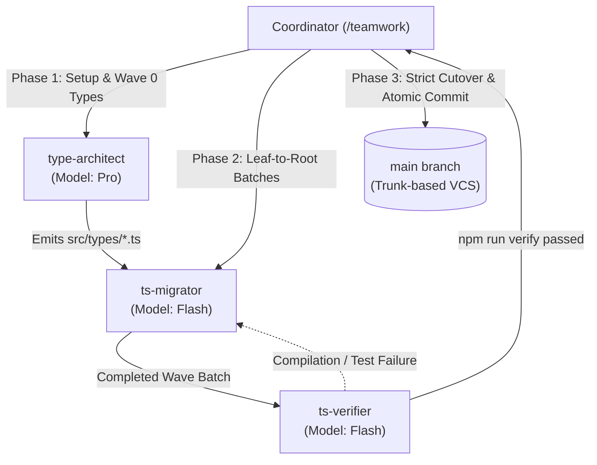
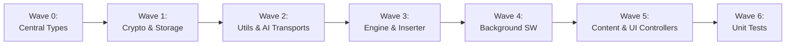

# JavaScript to TypeScript Migration Blueprint (Path A: Lightweight Bundler)

> **Project**: SmartForm AI (Manifest V3 Browser Extension)  
> **Status**: Ready for `/teamwork` Launch Approval  
> **Execution Model**: Multi-Agent Parallel Orchestration (`type-architect`, `ts-migrator`, `ts-verifier`)

---

## 1. Migration Overview & Strategy

This blueprint details the step-by-step conversion of SmartForm AI from plain JavaScript ES modules to strict, 100% type-safe TypeScript. We are adopting **Path A (Lightweight Bundler)** using `esbuild`. 

### Key Objectives
1. **Zero Runtime Overhead**: Fast (<50ms) compilation emitting standard ES modules into `dist/`.
2. **Type Safety Across Boundaries**: Complete type safety across Chrome messaging, `chrome.storage.local` / `session`, native Web Crypto envelopes, and multi-provider AI payloads.
3. **No Implicit or Explicit `any`**: Full adherence to `strict: true` and `noImplicitAny: true`.
4. **Preserved Clean Code Limits**: Strictly adhere to ESLint limits ($\le 200$ LOC per file, $\le 40$ LOC per function) and Mozilla add-on security rules (`no-unsanitized`).
5. **Continuous Verification**: All 6 automated test suites and linters pass after every single migration wave.

---

## 2. Multi-Agent Orchestration Structure

The migration will be executed using `/teamwork` with three specialized subagent roles:

- **`type-architect`** (Model: `pro`): Designs and maintains centralized definitions in `src/types/` (`domain.ts`, `storage.ts`, `messages.ts`, `engine.ts`).
- **`ts-migrator`** (Model: `flash`): Converts `.js` files to `.ts` in isolated dependency batches, replacing JSDoc casts with explicit types and keeping LOC limits under 200/40.
- **`ts-verifier`** (Model: `flash`): Runs `tsc --noEmit`, ESLint, Knip, and all 6 automated test suites after each wave to prevent regressions.

---

## 3. Phased Execution Plan

### Phase 1: Build Infrastructure & Setup
*Goal: Establish bundler pipeline and dual-mode TypeScript compiler configuration without breaking existing code.*

1. **Install Build Dependencies**:
   - Install `esbuild` and `typescript-eslint` tooling.
2. **Configure `esbuild` Build Pipeline (`build.js`)**:
   - Bundle entry points:
     - `src/background/service-worker.ts` $\rightarrow$ `dist/src/background/service-worker.js`
     - `src/content/content.ts` $\rightarrow$ `dist/src/content/content.js`
     - `src/content/inserter.ts` $\rightarrow$ `dist/src/content/inserter.js`
     - `src/engine/scanner.ts` $\rightarrow$ `dist/src/engine/scanner.js`
     - `src/engine/pattern-matcher.ts` $\rightarrow$ `dist/src/engine/pattern-matcher.js`
     - `src/popup/popup.ts` $\rightarrow$ `dist/src/popup/popup.js`
     - `src/options/options.ts` $\rightarrow$ `dist/src/options/options.js`
   - Static asset copy step:
     - Copy `manifest.json`, `src/icons/`, `src/**/*.html`, `src/**/*.css`, and `test-forms/` directly into `dist/`.
   - Add build flags: `--bundle`, `--format=esm`, `--target=es2022`, `--sourcemap`.
3. **Configure `tsconfig.json`**:
   - Replace `jsconfig.json` with an incremental TypeScript configuration:
     - `"allowJs": true`
     - `"checkJs": true`
     - `"strict": true`
     - `"noImplicitAny": true`
     - `"module": "ESNext"`
     - `"moduleResolution": "bundler"`
     - `"lib": ["DOM", "DOM.Iterable", "ES2022"]`
     - `"types": ["chrome", "node"]`
4. **Update `package.json` Scripts**:
   - `"build": "node build.js"`
   - `"watch": "node build.js --watch"`
   - `"type-check": "tsc --noEmit"`
   - `"verify": "npm run lint && npm run type-check && npm run knip && npm test && npm run build"`
5. **Verification**: Run `npm run verify` to confirm existing JS works cleanly under the new build pipeline.

---

### Phase 2: Leaf-to-Root Migration Waves

To eliminate circular dependencies and minimize merge conflicts, files are converted in order of dependency depth:

#### Wave 0: Centralized Type System (`type-architect`)
- **Files to Create**:
  - `src/types/domain.ts`: `Profile`, `CompanyProfile`, `ContactInfo`, `BusinessHours`, `FaqItem`, `LearnedField`.
  - `src/types/storage.ts`: `StorageLocalSchema`, `StorageSessionSchema`, `EncryptedVaultEnvelope`, `VaultStatus`, `ExportPayload`.
  - `src/types/messages.ts`: `ExtensionMessage` (discriminated union for all 14 actions), `MessageResponse<T>`.
  - `src/types/engine.ts`: `ScannedFormField`, `FillInstruction`, `MatcherResult`, `AiProviderConfig`, `AiRequestOptions`.
  - `src/types/index.ts`: Unified barrel exports.
- **Verification**: `npx tsc --noEmit`.

#### Wave 1: Core Leaf Services & Storage (`ts-migrator` Batch A)
- **Files to Convert** (9 files):
  - `src/services/crypto.js` $\rightarrow$ `crypto.ts`
  - `src/services/storage/storage-base.js` $\rightarrow$ `storage-base.ts`
  - `src/services/storage/storage-settings.js` $\rightarrow$ `storage-settings.ts`
  - `src/services/storage/storage-logs.js` $\rightarrow$ `storage-logs.ts`
  - `src/services/storage/storage-template.js` $\rightarrow$ `storage-template.ts`
  - `src/services/storage/storage-profiles.js` $\rightarrow$ `storage-profiles.ts`
  - `src/services/storage/storage-vault.js` $\rightarrow$ `storage-vault.ts`
  - `src/services/storage/storage-vault-setup.js` $\rightarrow$ `storage-vault-setup.ts`
  - `src/services/storage.js` $\rightarrow$ `src/services/storage.ts` (facade)
- **Verification**: `ts-verifier` runs `npm run verify`.

#### Wave 2: Utilities & AI Transports (`ts-migrator` Batch B)
- **Files to Convert** (9 files):
  - `src/utils/legacy-importer.js` $\rightarrow$ `legacy-importer.ts`
  - `src/utils/importer.js` $\rightarrow$ `importer.ts`
  - `src/utils/exporter.js` $\rightarrow$ `exporter.ts`
  - `src/engine/ai/prompt-builder.js` $\rightarrow$ `prompt-builder.ts`
  - `src/engine/ai/response-parser.js` $\rightarrow$ `response-parser.ts`
  - `src/engine/ai/gemini-transport.js` $\rightarrow$ `gemini-transport.ts`
  - `src/engine/ai/openai-transport.js` $\rightarrow$ `openai-transport.ts`
  - `src/engine/ai/claude-transport.js` $\rightarrow$ `claude-transport.ts`
  - `src/engine/ai/custom-transport.js` $\rightarrow$ `custom-transport.ts`
- **Verification**: `ts-verifier` runs `npm run verify`.

#### Wave 3: Engine Core & DOM Inserter (`ts-migrator` Batch C)
- **Files to Convert** (5 files):
  - `src/engine/scanner-rules.js` $\rightarrow$ `scanner-rules.ts`
  - `src/engine/pattern-matcher.js` $\rightarrow$ `pattern-matcher.ts`
  - `src/engine/ai-agent.js` $\rightarrow$ `ai-agent.ts`
  - `src/engine/scanner.js` $\rightarrow$ `scanner.ts`
  - `src/content/inserter.js` $\rightarrow$ `src/content/inserter.ts`
- **Verification**: `ts-verifier` runs `npm run verify`.

#### Wave 4: Background Service Worker (`ts-migrator` Batch D)
- **Files to Convert** (2 files):
  - `src/background/message-handlers.js` $\rightarrow$ `message-handlers.ts`
  - `src/background/service-worker.js` $\rightarrow$ `service-worker.ts`
- **Verification**: `ts-verifier` runs `npm run verify`.

#### Wave 5: Content Script & UI Controllers (`ts-migrator` Batch E)
- **Files to Convert** (16 files):
  - Content components:
    - `src/content/toast.js` $\rightarrow$ `toast.ts`
    - `src/content/learning-card.js` $\rightarrow$ `learning-card.ts`
    - `src/content/unlock-modal.js` $\rightarrow$ `unlock-modal.ts`
    - `src/content/floating-button.js` $\rightarrow$ `floating-button.ts`
    - `src/content/content.js` $\rightarrow$ `content.ts`
  - Popup UI:
    - `src/popup/popup.js` $\rightarrow$ `popup.ts`
  - Options Dashboard Controllers:
    - `src/options/controllers/common.js` $\rightarrow$ `common.ts`
    - `src/options/controllers/tab-controller.js` $\rightarrow$ `tab-controller.ts`
    - `src/options/controllers/profiles-collections.js` $\rightarrow$ `profiles-collections.ts`
    - `src/options/controllers/profiles-form.js` $\rightarrow$ `profiles-form.ts`
    - `src/options/controllers/profiles-controller.js` $\rightarrow$ `profiles-controller.ts`
    - `src/options/controllers/ai-controller.js` $\rightarrow$ `ai-controller.ts`
    - `src/options/controllers/preferences-controller.js` $\rightarrow$ `preferences-controller.ts`
    - `src/options/controllers/vault-controller.js` $\rightarrow$ `vault-controller.ts`
    - `src/options/controllers/import-export-controller.js` $\rightarrow$ `import-export-controller.ts`
    - `src/options/controllers/logs-controller.js` $\rightarrow$ `logs-controller.ts`
    - `src/options/options.js` $\rightarrow$ `options.ts`
- **Verification**: `ts-verifier` runs `npm run verify`.

#### Wave 6: Unit Test Alignment (`ts-migrator` Batch F)
- **Files to Update** (6 test files in `test/`):
  - Align test imports with compiled outputs or TypeScript runner (`test/test-*.js`).
  - Ensure all 6 test suites execute cleanly against the TypeScript codebase.
- **Verification**: `ts-verifier` runs `npm test`.

---

### Phase 3: Strict Cutover & Hardening
*Goal: Enforce 100% strict TypeScript, disable JS fallback, and produce production distribution.*

1. **Lock Down Compiler Settings (`tsconfig.json`)**:
   - `"allowJs": false`
   - `"noImplicitAny": true`
   - `"strictNullChecks": true`
   - Remove legacy `jsconfig.json`.
2. **Update ESLint & Knip**:
   - Point Knip entries exclusively to `.ts` entry points.
   - Remove JS-only exceptions.
3. **Full End-to-End Build & Validation**:
   - Run `npm run verify`.
   - Inspect `dist/` directory to verify:
     - All HTML, CSS, assets, and icons exist in `dist/`.
     - `dist/manifest.json` points to valid bundled `.js` entry points.
     - Content scripts and background service worker load properly without module resolution errors.
4. **Git Trunk Commit**:
   - Create clean, atomic commit to `main`: `chore(migration): complete full typescript migration with strict types and esbuild pipeline`.
